<div align="center">

# n8n-hubspot-closed-won-case-study-generator-ai

**Automated AI workflow that extracts success metrics and project highlights from closed-won HubSpot deals and call transcripts, drafting formatted case study copy in Notion or Google Docs.**

A dhRobin Systems Revenue Infrastructure blueprint

      

</div>

---

## Table of Contents

1. [Overview](#1-overview)
2. [Architecture and Data Flow](#2-architecture-and-data-flow)
3. [Repository Contents](#3-repository-contents)
4. [Prerequisites](#4-prerequisites)
5. [5-Minute Sandbox Quick Start](#5-5-minute-sandbox-quick-start)
6. [Step-by-Step Import and Go-Live Guide](#6-step-by-step-import-and-go-live-guide)
7. [Environment Variables](#7-environment-variables)
8. [Node-by-Node Configuration Guide](#8-node-by-node-configuration-guide)
9. [Grounding Rules and AI Contract](#9-grounding-rules-and-ai-contract)
10. [Safety Matrix](#10-safety-matrix)
11. [Data Protection and Compliance](#11-data-protection-and-compliance)
12. [Operations and Troubleshooting](#12-operations-and-troubleshooting)
13. [Disclaimer and License](#13-disclaimer-and-license)

---

## 1. Overview

The best evidence for a case study is already in the CRM and the call recorder on the day a deal closes. By the time marketing asks for it, nobody remembers who said "planning time dropped from 14 hours to under 3". I built this workflow to capture that evidence while it is fresh. When a HubSpot deal moves to Closed Won, it collects the deal, the company, the call notes and the call transcripts. An LLM then extracts the quantitative results (ROI, time saved, revenue growth, cost and quality gains) and the qualitative story, and the workflow writes a formatted case study draft in Notion or Google Docs.

AI-written case studies have one failure mode that matters: invented numbers and quotes that end up in public. So the model only proposes, and a deterministic grounding gate decides what goes in the draft:

- A **metric** is kept only if its evidence excerpt appears verbatim in the cited source and states the value. Figures stated by a customer are marked *verified*. Figures stated by your own team (vendor speakers, deal description, call notes) move to **Open questions** for customer confirmation.
- A **quote** is kept only if it appears verbatim in a customer speaker's words. The attribution (job title plus company) is taken from the transcript, never from the model.
- Everything that fails is listed in the draft's **Open questions for the customer**. It is never presented as fact.

**Per closed-won deal, the workflow:**

1. Verifies the HubSpot v3 webhook signature, keeps only `dealstage` changes into `CLOSED_WON_STAGE_IDS`, ignores its own writes, and drops retried deliveries.
2. Reads the deal, its primary company (including the consent property) and its associated calls from HubSpot.
3. Loads transcripts from **Gong**, a **generic transcript API** (the adapter contract for Zoom or any recorder), or uses HubSpot call notes only.
4. Applies eligibility: never drafts for companies with `case_study_consent = no`, skips deals that already have a draft, and enforces `MIN_DEAL_AMOUNT` and a minimum amount of evidence.
5. Builds numbered sources (`DEAL`, `C1…`, `T1…`), replaces speakers with role labels, and redacts emails and phone numbers.
6. Calls **OpenAI** (strict JSON Schema) or **Anthropic** (forced tool call) with a structured extraction prompt.
7. Validates every metric and quote, then renders the draft as Notion blocks or as a Google Doc.
8. Optionally writes the draft URL and status back to the HubSpot deal, and always emits an audit record.

**Design principles**

| Principle | Implementation |
|---|---|
| Safe by default | With no environment variables set, the workflow makes **zero external API calls and zero writes**. |
| Drafts, never publications | Every document is titled `[DRAFT]`, opens with a review banner showing the customer's consent status, and ends with an internal evidence appendix. |
| Consent first | `case_study_consent = no` on the company means no AI call and no document. Any value other than `yes` adds a "do not share" banner. |
| Grounded output | Metrics and quotes are checked against the source text in code (see [§9](#9-grounding-rules-and-ai-contract)). |
| Minimum personal data to the AI | Speakers become `Customer · VP Operations` / `Vendor · Account Executive`. Emails and phone numbers become `[EMAIL]` / `[PHONE]` before the prompt is built. |
| Secrets out of data | Every token appears only as `{{ $env.* }}` in HTTP header fields. The one documented exception is the webhook signing secret (see [§8.2](#82-parse--verify-deal-events)). |

---

## 2. Architecture and Data Flow

```mermaid
flowchart LR
    subgraph Trigger
        WH[HubSpot: Deal Stage Webhook<br/>deal.propertyChange · dealstage]
        MT[Manual Test Trigger] --> SY[Build Synthetic Deal Events]
    end
    WH --> CFG[Config & Safety Gate]
    SY --> CFG
    CFG --> PV[Parse & Verify Deal Events<br/>v3 signature · closed-won filter · loop guard · dedupe]
    PV --> HD{Has Closed-Won Deals?}
    HD -- no --> AUD
    HD -- yes --> SB{Sandbox Mode?}
    SB -- yes --> MOCK[Mock Deal Context]
    SB -- no --> SPL[Split Deals] --> GD[HubSpot: Get Deal] --> IDX[Index Deal Associations]
    IDX --> BC[HubSpot: Batch Read Companies] --> BCL[HubSpot: Batch Read Calls] --> CDC[Collect Deal Context]
    CDC --> TG{Transcripts: Gong?}
    TG -- yes --> GL[Gong: List Calls] --> GM[Match Gong Calls to Deals] --> GQ{Matched?}
    GQ -- yes --> GT[Gong: Get Transcripts] --> ASM
    GQ -- no --> ASM
    TG -- no --> TA{Transcripts: Generic API?}
    TA -- yes --> GR[Build Generic Transcript Requests] --> TF[Transcript API: Fetch by Deal] --> ASM
    TA -- no --> ASM
    MOCK --> ASM[Assemble Case Study Context<br/>consent · existing draft · evidence · redaction]
    ASM --> HE{Has Eligible Deals?}
    HE -- no --> AUD
    HE -- yes --> AIR[Build AI Extraction Requests] --> AL{AI Live?}
    AL -- no --> MAI[Mock AI Extraction]
    AL -- yes --> PA{Provider: Anthropic?}
    PA -- yes --> ANT[Anthropic: Extract Case Study]
    PA -- no --> OAI[OpenAI: Extract Case Study]
    MAI --> VAL
    ANT --> VAL
    OAI --> VAL[Validate & Render Case Study Drafts<br/>grounding gate]
    VAL --> DR{Dry Run?}
    DR -- yes --> AUD
    DR -- no --> CD{Create Document?}
    CD -- no --> AUD
    CD -- yes --> ED[Emit Drafts] --> TN{Target: Notion?}
    TN -- yes --> NP[Notion: Create Draft Page] --> CR
    TN -- no --> GDR[Google Drive: Create Doc] --> GDW[Google Docs: Write Draft Content] --> CR
    CR[Collect Document Results] --> WB{Write Back to HubSpot?}
    WB -- yes --> HU[HubSpot: Batch Update Deals] --> AUD
    WB -- no --> AUD[Execution Summary & Audit]
```



### Stage contracts

| Stage | Output shape |
|---|---|
| Parse & Verify Deal Events | `{ signature, counters, deals: [{ dealId, portalId, closedWonAt, stageId }] }` |
| Collect Deal Context / Mock Deal Context | `{ deals: [{ dealId, deal{}, companyId, company{}, calls[] }], failed[] }` (mock adds `transcripts[]`) |
| Assemble Case Study Context | One item per eligible deal: `{ dealId, consent, customer{}, deal{}, sources: [{ id, kind, side, label, text, segments[] }] }` |
| Build AI Extraction Requests | Same item plus `aiRequest` (provider-specific body) |
| Validate & Render Case Study Drafts | `{ dealId, ok, status, draft{ metrics[], quotes[], openQuestions[] }, rejected[], notionBody, driveBody, gdocBody }` |
| Collect Document Results | `{ docs: [{ dealId, target, docId, url, error }], writeBack[], counts }` |
| Execution Summary & Audit | Outcome, safety flags, event counters, skips, per-draft verification counts, documents, write-back totals |

---

## 3. Repository Contents

```
n8n-hubspot-closed-won-case-study-generator-ai/
├── README.md                                Technical documentation (this file)
├── workflow.json                            Importable n8n workflow with sticky notes and pinned synthetic payloads
├── DISCLAIMER.md                            Liability limitation and usage terms
├── LICENSE                                  MIT License
└── sample-payloads/
    ├── deal-closed-won-webhook.json         Synthetic HubSpot webhook batch (closed won, other stage, retry, declined consent)
    └── call-transcript-mock.json            Synthetic transcripts in the generic transcript contract (§8.6)
```

All companies, people, IDs and figures in these files are fictitious. Domains use the reserved `.example` TLD.

---

## 4. Prerequisites

| Requirement | Detail |
|---|---|
| n8n | Self-hosted **1.60 or later** (Webhook 2, Set 3.4, IF 2, Code 2, HTTP Request 4.2 with pagination, `v1` execution order). |
| Env access | `N8N_BLOCK_ENV_ACCESS_IN_NODE=false`. Recent n8n releases block `$env` in nodes by default, so set this explicitly. |
| Crypto in Code nodes | `NODE_FUNCTION_ALLOW_BUILTIN=crypto` for webhook signature verification. |
| HubSpot private app | Scopes `crm.objects.deals.read`, `crm.objects.companies.read`, the read scope HubSpot lists for the Calls API in your portal, and `crm.objects.deals.write` if you enable write-back. |
| HubSpot public app (trigger) | A developer app with a webhook subscription to `deal.propertyChange` on `dealstage`, pointed at the n8n webhook URL. Its client secret verifies signatures. |
| HubSpot properties | Company property `case_study_consent` (dropdown: `yes`, `pending`, `no`). For write-back, deal properties `case_study_status` (single-line text), `case_study_draft_url` (single-line text), `case_study_generated_at` (date picker or text). |
| AI provider | An OpenAI or Anthropic API key, sent from `AI_API_KEY`. Any OpenAI-compatible endpoint that supports `response_format: json_schema` also works through `AI_API_BASE_URL`. |
| Transcripts (optional) | **Gong:** API access key and secret. **Zoom or another recorder:** a small adapter endpoint that implements [§8.6](#86-transcript-api-fetch-by-deal-generic-and-zoom-adapter). **None:** HubSpot call notes only. |
| Document target | **Notion:** an internal integration token with the target database or page shared with it. **Google Docs:** an OAuth 2.0 access token with `drive.file` scope (see the note below). |

> **Google Docs needs an OAuth access token, not an API key.** `GOOGLE_DOCS_ACCESS_TOKEN` is sent as `Authorization: Bearer …`, so it must hold a currently valid token (about one hour), refreshed by a token broker or your secret manager. On n8n Cloud, or if you prefer managed refresh, replace those two HTTP nodes' header with an n8n Google OAuth2 credential. The node logic is unchanged.

> **n8n Cloud:** you can't define your own environment variables on n8n Cloud. Replace each `$env.X` with `$vars.X` (on plans with Variables) or with n8n credentials. The workflow logic is unchanged.

**Why a Webhook node instead of the built-in HubSpot Trigger.** The HubSpot Trigger node can only authenticate with a stored HubSpot developer credential, which conflicts with environment-variable-only authentication. A Webhook node that receives HubSpot's own `deal.propertyChange` subscription delivers the same events, and the signature check in [§8.2](#82-parse--verify-deal-events) authenticates them.

---

## 5. 5-Minute Sandbox Quick Start

1. **Run n8n locally:**
   ```bash
   docker run -it --rm -p 5678:5678 \
     -e N8N_BLOCK_ENV_ACCESS_IN_NODE=false \
     -e NODE_FUNCTION_ALLOW_BUILTIN=crypto \
     -e GENERIC_TIMEZONE=UTC \
     -v n8n_data:/home/node/.n8n \
     docker.n8n.io/n8nio/n8n
   ```
2. **Import** `workflow.json` (*Workflows → Import from File*).
3. Click **Test workflow** on *Manual Test Trigger*.
4. Open **Validate & Render Case Study Drafts** and **Execution Summary & Audit**.

**Expected sandbox result** (4 synthetic events, no credentials, nothing sent):

| Event | Result |
|---|---|
| Deal `5200000001` → `closedwon` (Brightline Example) | Drafted, status `draft_ready`, confidence `medium` |
| Deal `5200000002` → `contractsent` | Ignored: `notClosedWon` |
| Retried delivery of deal `5200000001` | Ignored: `duplicate` |
| Deal `5200000003` → `closedwon` (Cobalt Ridge Example) | Skipped before the AI call: `consent_declined` |

| Draft element | Outcome |
|---|---|
| Weekly route-planning time: under 3 hours/week (from about 14) | ✅ Verified, customer-stated (T2) |
| On-time delivery: 96% (from 82%) | ✅ Verified, customer-stated (T2) |
| Fuel spend per stop: 11% reduction | ✅ Verified, customer-stated (T2) |
| Payback period: five months | ⚠️ Vendor-stated (the account executive said it) → moved to Open questions |
| "Honestly, this is the first tool our dispatchers asked to keep after a pilot." | ✅ Verbatim, attributed to *VP Operations, Brightline Example* |
| "This platform transformed our entire business overnight." | ❌ Not in any transcript → removed and listed in Open questions |

The phone number and email spoken in the synthetic transcripts reach the AI request as `[PHONE]` and `[EMAIL]`. The rendered draft is available as `notionBody` (36 blocks) and `gdocBody` (one insert plus heading, bullet and italic styles) on the validation node.

---

## 6. Step-by-Step Import and Go-Live Guide

Each step changes one thing and has an exit check. Move on only when the check passes.

| Step | Configuration | Exit check |
|---|---|---|
| **1. Import and sandbox** | Defaults | The tables in [§5](#5-5-minute-sandbox-quick-start) are reproduced. |
| **2. Pinned live path** | `SANDBOX_MODE=false`, `REQUIRE_HUBSPOT_SIGNATURE=false`, `TRANSCRIPT_SOURCE=gong`, `AI_MODE=live`, `DRY_RUN=false`, `CREATE_DOCUMENT=true`, `NOTION_PARENT_ID=test`, `WRITE_BACK_TO_HUBSPOT=true`. Run **Test workflow** from *HubSpot: Deal Stage Webhook*. Repeat with `AI_PROVIDER=anthropic`, `TRANSCRIPT_SOURCE=generic` (+ any `TRANSCRIPT_API_URL`) and `DOCUMENT_TARGET=google_docs` | Every HTTP node runs on pinned synthetic data, `outcome: completed`, one document, one write-back. No real request leaves n8n. |
| **3. HubSpot setup** | Create the properties from [§4](#4-prerequisites). Set `case_study_consent` on a test company. Create the private app. | A test deal and its company are visible to the token. |
| **4. Live reads, dry run** | Unpin the HubSpot, transcript and AI nodes (*right-click → Unpin*). `DRY_RUN=true`, real `HUBSPOT_PRIVATE_APP_TOKEN`, `AI_API_KEY`, transcript credentials. Replace the pinned webhook with a real deal ID (edit the pinned body). | The validation node shows real sources, and each verified metric checks out against the transcript. |
| **5. Document creation** | Unpin the document nodes. `DRY_RUN=false`, `CREATE_DOCUMENT=true`, Notion or Google credentials | A `[DRAFT]` page or doc appears in the target location with banner, sections and evidence appendix. |
| **6. Write-back** | Unpin *HubSpot: Batch Update Deals*. `WRITE_BACK_TO_HUBSPOT=true` | The deal shows `case_study_draft_url`. Re-running for the same deal is skipped (`draft_already_exists`). |
| **7. Webhook** | Set the HubSpot app webhook URL to the n8n **production** URL, `REQUIRE_HUBSPOT_SIGNATURE=true`, `HUBSPOT_APP_CLIENT_SECRET`, `HUBSPOT_WEBHOOK_PUBLIC_URL`, `HUBSPOT_APP_ID`, then activate the workflow | Moving a test deal to Closed Won produces a draft within a minute. The workflow's own write-back doesn't re-trigger it. |
| **8. Production** | Production portal and keys, `CLOSED_WON_STAGE_IDS` for every pipeline | Marketing reviews the first ten drafts against the evidence appendix before anyone contacts a customer. |

**Finding closed-won stage IDs:** *Settings → Objects → Deals → Pipelines*. The default pipeline uses `closedwon`. Custom pipelines use numeric IDs, so list all of them in `CLOSED_WON_STAGE_IDS`.

---

## 7. Environment Variables

All variables are optional. Unset values resolve to the safest behaviour. Secrets are read only inside HTTP header fields, except `HUBSPOT_APP_CLIENT_SECRET` ([§8.2](#82-parse--verify-deal-events)).

### 7.1 Safety gate

| Variable | Default | Effect |
|---|---|---|
| `SANDBOX_MODE` | `true` | Synthetic deals, transcripts and mock AI. Forces zero external calls regardless of the flags below. |
| `DRY_RUN` | `true` | Drafts are rendered but never saved. |
| `CREATE_DOCUMENT` | `false` | Creates the Notion page or Google Doc. Effective only when `SANDBOX_MODE=false` and `DRY_RUN=false`. |
| `WRITE_BACK_TO_HUBSPOT` | `false` | Writes `case_study_status`, `case_study_draft_url` and `case_study_generated_at` to the deal. Effective only when documents are created. |
| `AI_MODE` | `mock` | `live` calls the AI provider. Effective only when `SANDBOX_MODE=false`. |

### 7.2 AI

| Variable | Default | Effect |
|---|---|---|
| `AI_API_KEY` 🔒 | — | OpenAI `Authorization: Bearer` or Anthropic `x-api-key`. |
| `AI_PROVIDER` | `openai` | `openai` or `anthropic`. |
| `AI_MODEL` | `gpt-4.1-mini` / `claude-sonnet-5-5` | Model ID. Temperature is omitted automatically for `o*` and `gpt-5*` models. |
| `AI_API_BASE_URL` | Provider default | Override for an OpenAI-compatible gateway or a regional endpoint. |

### 7.3 Deal selection and eligibility

| Variable | Default | Effect |
|---|---|---|
| `CLOSED_WON_STAGE_IDS` | `closedwon` | Comma-separated stage IDs that count as Closed Won. |
| `MIN_DEAL_AMOUNT` | `0` | Skip deals below this amount. |
| `MAX_DEALS_PER_RUN` | `10` (1–25) | Cap per webhook batch. |
| `CONSENT_PROPERTY` | `case_study_consent` | Company property. `no` = skip. Anything but `yes` = "do not share" banner. |
| `REGENERATE_EXISTING` | `false` | Draft again even when `case_study_draft_url` is already set. |
| `MIN_EVIDENCE_CHARS` | `200` | Minimum call-note plus transcript text required before an AI call. |
| `DEDUPE_HOURS` | `72` | Production-only memory of processed deal IDs. |

### 7.4 Transcripts

| Variable | Default | Effect |
|---|---|---|
| `TRANSCRIPT_SOURCE` | `hubspot` | `hubspot` (call notes only), `gong`, `generic` or `none`. |
| `GONG_BASIC_AUTH` 🔒 | — | `base64(accessKey:accessKeySecret)`, sent as `Authorization: Basic`. |
| `GONG_API_BASE_URL` | `https://api.gong.io` | Your tenant's API base URL if Gong assigns one. |
| `GONG_MATCH_BY_DOMAIN` | `true` | Fall back to matching an external participant's email domain to the company domain. |
| `TRANSCRIPT_API_URL` | — | Generic adapter endpoint ([§8.6](#86-transcript-api-fetch-by-deal-generic-and-zoom-adapter)). |
| `TRANSCRIPT_API_KEY` 🔒 | — | Bearer token for the adapter. |
| `TRANSCRIPT_LOOKBACK_DAYS` | `120` | Window for transcript lookup. |
| `MAX_CALLS_PER_DEAL` | `5` | Most recent calls/transcripts per deal. |
| `MAX_TRANSCRIPT_CHARS` | `40000` | Per-transcript truncation before the prompt. |
| `INCLUDE_SPEAKER_NAMES` | `false` | `true` adds speaker names to labels. Leave off unless you have a basis to send names to the AI provider. |

### 7.5 Documents

| Variable | Default | Effect |
|---|---|---|
| `DOCUMENT_TARGET` | `notion` | `notion` or `google_docs`. |
| `NOTION_API_KEY` 🔒 | — | Notion internal integration token. |
| `NOTION_PARENT_ID` | — | Database ID or page ID. |
| `NOTION_PARENT_TYPE` | `database` | `database` or `page`. |
| `NOTION_TITLE_PROPERTY` | `Name` | Title property of the database. |
| `GOOGLE_DOCS_ACCESS_TOKEN` 🔒 | — | OAuth 2.0 access token, scope `drive.file`. |
| `GOOGLE_DRIVE_FOLDER_ID` | — | Target folder. Empty = the token owner's My Drive. |
| `DRAFT_TITLE_PREFIX` | `[DRAFT]` | Document title prefix. |

### 7.6 HubSpot and webhook

| Variable | Default | Effect |
|---|---|---|
| `HUBSPOT_PRIVATE_APP_TOKEN` 🔒 | — | Private app token. |
| `HUBSPOT_APP_CLIENT_SECRET` 🔒 | — | Webhook signature secret (Code node exception). |
| `REQUIRE_HUBSPOT_SIGNATURE` | `true` | Reject unsigned or invalid webhook requests outside sandbox. |
| `HUBSPOT_WEBHOOK_PUBLIC_URL` | — | Exact public URL HubSpot calls. Needed when n8n sits behind a proxy. |
| `HUBSPOT_APP_ID` | — | Events whose `sourceId` equals this value are ignored (loop guard). |
| `HUBSPOT_API_BASE_URL` | `https://api.hubapi.com` | API base URL. |

🔒 = secret. Inject from a secret manager, never commit.

### 7.7 Sample `.env` (staging)

```bash
# n8n runtime
N8N_BLOCK_ENV_ACCESS_IN_NODE=false
NODE_FUNCTION_ALLOW_BUILTIN=crypto

# Safety gate: live reads and live AI, nothing saved yet
SANDBOX_MODE=false
DRY_RUN=true
CREATE_DOCUMENT=false
WRITE_BACK_TO_HUBSPOT=false
AI_MODE=live

# Secrets (inject from your secret manager; never commit)
HUBSPOT_PRIVATE_APP_TOKEN=
HUBSPOT_APP_CLIENT_SECRET=
AI_API_KEY=
GONG_BASIC_AUTH=
NOTION_API_KEY=

# Routing
AI_PROVIDER=openai
TRANSCRIPT_SOURCE=gong
DOCUMENT_TARGET=notion
NOTION_PARENT_ID=00000000000000000000000000000000
CLOSED_WON_STAGE_IDS=closedwon
HUBSPOT_APP_ID=0000000
HUBSPOT_WEBHOOK_PUBLIC_URL=https://n8n.company.example/webhook/hubspot/deal-closed-won
```

---

## 8. Node-by-Node Configuration Guide

### 8.1 Triggers

- **HubSpot: Deal Stage Webhook** (`POST /webhook/hubspot/deal-closed-won`) responds `200` immediately, so HubSpot doesn't retry. HubSpot batches up to 100 events per request. Every event is evaluated.
- **Manual Test Trigger → Build Synthetic Deal Events** emits the same body as `sample-payloads/deal-closed-won-webhook.json`.

### 8.2 Parse & Verify Deal Events

Outside sandbox, the node verifies `X-HubSpot-Signature-v3`: HMAC-SHA256 over `POST + URL + raw body + timestamp`, base64, constant-time compare, plus a 5-minute timestamp window.

**Documented exception:** an HMAC can't be computed in an HTTP header field, so this Code node reads `HUBSPOT_APP_CLIENT_SECRET` in memory. It never writes the secret to its output. n8n re-serialises the webhook body, so verify against a real delivery in step 7 of [§6](#6-step-by-step-import-and-go-live-guide). If it fails behind a proxy, set `HUBSPOT_WEBHOOK_PUBLIC_URL` to the exact URL HubSpot calls.

It then keeps `deal.propertyChange` events for `dealstage` whose new value is in `CLOSED_WON_STAGE_IDS`, drops events from `HUBSPOT_APP_ID` and in-batch duplicates, and in production executions skips deals processed within `DEDUPE_HOURS`.

### 8.3 HubSpot reads

| Node | Call | Notes |
|---|---|---|
| HubSpot: Get Deal | `GET /crm/v3/objects/deals/{id}?properties=…&associations=companies,calls` | One request per deal. Failures continue and are reported as `deal_read_failed`. |
| Index Deal Associations | — | Primary company (falls back to the first), the `MAX_CALLS_PER_DEAL` most recent calls. |
| HubSpot: Batch Read Companies | `POST /crm/v3/objects/companies/batch/read` | Name, domain, industry, size, country, `CONSENT_PROPERTY`. |
| HubSpot: Batch Read Calls | `POST /crm/v3/objects/calls/batch/read` | `hs_call_title`, `hs_call_body`, `hs_timestamp`. Call notes become sources `C1…`. |

### 8.4 Gong (`TRANSCRIPT_SOURCE=gong`)

1. **Gong: List Calls** posts to `/v2/calls/extensive` with `contentSelector.context = "Extended"` and `exposedFields.parties = true`, paginated by `records.cursor` (max 20 pages).
2. **Match Gong Calls to Deals** links a call to a deal when its CRM context contains a Deal/Opportunity object with the HubSpot deal ID. Otherwise, with `GONG_MATCH_BY_DOMAIN=true`, it matches when an external participant's email domain equals the company domain.
3. **Gong: Get Transcripts** posts the matched call IDs to `/v2/calls/transcript`. Monologues are flattened into speaker segments, and the party's `affiliation` decides Customer vs. Vendor.

Required Gong API permissions: list calls with extensive data and read transcripts. A `404` (no calls in the window) is tolerated.

### 8.5 HubSpot call notes only (`TRANSCRIPT_SOURCE=hubspot`, default)

No transcript API is called. Call notes (`C1…`) and the deal record are the only evidence. Notes rarely reach `MIN_EVIDENCE_CHARS`, so this mode mostly produces `insufficient_evidence` skips. That's deliberate: a case study shouldn't be written from a deal description.

### 8.6 Transcript API: Fetch by Deal (generic and Zoom adapter)

`TRANSCRIPT_SOURCE=generic` sends one request per deal:

```
GET {TRANSCRIPT_API_URL}?dealId=5200000001&companyDomain=brightline.example&since=2026-07-19T00:00:00Z&limit=5
Authorization: Bearer {{ $env.TRANSCRIPT_API_KEY }}
```

The endpoint returns the shape in `sample-payloads/call-transcript-mock.json`:

```json
{ "transcripts": [ {
    "callId": "call-syn-0002", "title": "…", "startedAt": "2026-10-28T16:00:00Z", "durationSec": 3000,
    "participants": [ { "speakerId": "s1", "name": "…", "affiliation": "external", "title": "VP Operations" } ],
    "segments": [ { "speakerId": "s1", "startMs": 72000, "text": "…" } ] } ] }
```

`affiliation` must be `internal` (your team) or `external` (the customer). It drives quote verification.

**For Zoom**, the adapter looks up meetings with the customer (for example by participant domain), downloads the cloud-recording `TRANSCRIPT` (VTT) file through the Zoom Recordings API, splits cues into segments, and marks participants from your account domain as `internal`. The same adapter fronts any other recorder.

### 8.7 Assemble Case Study Context

Merges deals with transcripts and applies, in order: consent (`no` → `consent_declined`), existing draft (`draft_already_exists` unless `REGENERATE_EXISTING=true`), `MIN_DEAL_AMOUNT`, `MIN_EVIDENCE_CHARS`. Builds the numbered sources: `DEAL` (deal record), `C1…` (call notes), `T1…` (transcripts as `[Customer · VP Operations] text` lines), all HTML-stripped and with emails and phone numbers redacted.

### 8.8 AI extraction

**Build AI Extraction Requests** creates one request per deal:

- **OpenAI:** `POST {base}/chat/completions` with `response_format: { type: "json_schema", strict: true }`.
- **Anthropic:** `POST {base}/messages`, `anthropic-version: 2023-06-01`, a single `record_case_study` tool with `tool_choice` forcing it.

Both nodes use `continueRegularOutput`, so a failed call becomes `ai_request_failed` for that deal instead of stopping the run. **Mock AI Extraction** returns a deterministic draft, including one vendor-stated figure and one invented quote, so you can see the grounding gate reject them.

### 8.9 Validate & Render Case Study Drafts

Applies [§9](#9-grounding-rules-and-ai-contract), then renders. The draft is structured as follows:

1. Review banner (status and consent)
2. Headline and subheadline
3. At a glance (industry, size, region, customer since, all from HubSpot)
4. The challenge, The solution, Implementation highlights
5. Results (verified metrics only, with baseline and timeframe), plus a results summary
6. In their words (verified quotes)
7. Open questions for the customer (to-do items)
8. Evidence appendix (internal, remove before publishing)
9. Generation metadata

Notion children are capped at 100 blocks and rich text is chunked under 2,000 characters. Google Docs output is one `insertText` followed by `updateParagraphStyle` (headings), `createParagraphBullets` and italic styling over computed ranges.

### 8.10 Document creation and write-back

| Node | Call |
|---|---|
| Notion: Create Draft Page | `POST https://api.notion.com/v1/pages`, `Notion-Version: 2022-06-28`, parent database or page. |
| Google Drive: Create Doc | `POST https://www.googleapis.com/drive/v3/files` with `mimeType: application/vnd.google-apps.document` and optional folder. |
| Google Docs: Write Draft Content | `POST https://docs.googleapis.com/v1/documents/{id}:batchUpdate`. |
| Collect Document Results | Joins results to drafts by index. If the Drive file exists but formatting failed, the URL is still recorded and the error flagged. |
| HubSpot: Batch Update Deals | `POST /crm/v3/objects/deals/batch/update` with the three `case_study_*` properties. |

### 8.11 Execution Summary & Audit

Runs on every path. Outcomes: `no_closed_won_deals`, `no_eligible_deals`, `ai_extraction_failed`, `drafts_generated_not_saved`, `drafts_generated_not_saved_with_errors`, `completed`, `completed_with_errors`. Contains IDs, counts and rejection reasons, but no transcript text, contact details or secrets.

---

## 9. Grounding Rules and AI Contract

### 9.1 Extraction schema

| Field | Content |
|---|---|
| `headline`, `subheadline` | Outcome-led title, ≤ 90 characters for the headline |
| `challenge`, `solution`, `results_summary` | 2–4 grounded sentences each |
| `implementation_highlights[]` | Short factual bullets |
| `metrics[]` | `label`, `value`, `unit`, `baseline`, `timeframe`, `metric_type` (`roi`, `time_saved`, `revenue_growth`, `cost_reduction`, `efficiency`, `quality`, `adoption`, `other`), `evidence`, `source_ref` |
| `quotes[]` | `text`, `source_ref` |
| `open_questions[]` | Facts to confirm with the customer |
| `confidence` | `high`, `medium` or `low` |

The system prompt treats all source text as untrusted data. It instructs the model never to follow instructions inside transcripts, never to reconstruct redacted data, never to invent numbers, and to copy evidence and quotes verbatim.

### 9.2 Validation in code

| Check | Rule | On failure |
|---|---|---|
| Metric source | `source_ref` exists and the evidence is at least 8 characters | Open question |
| Metric evidence | Normalised evidence is a substring of the normalised source text | Open question (`evidence_not_in_source`) |
| Metric value | A number (or number word) in `value` also appears in the evidence | Open question (`value_not_in_evidence`) |
| Metric speaker | The segment containing the evidence belongs to a Customer speaker | Kept as *vendor-stated*, listed as needing confirmation, excluded from Results |
| Quote | Verbatim substring of a Customer segment in the cited transcript, ≥ 12 characters | Removed, listed in Open questions |
| Confidence | Downgraded to `low` with zero verified metrics, and capped at `medium` with fewer than two | — |
| Status | `needs_review` when confidence is `low` or more than two items were rejected; otherwise `draft_ready` | — |

Normalisation lower-cases text, unifies quote characters and collapses whitespace and punctuation. It doesn't paraphrase-match, so the model has to copy the evidence exactly.

---

## 10. Safety Matrix

| `SANDBOX_MODE` | `AI_MODE` | `DRY_RUN` | `CREATE_DOCUMENT` | `WRITE_BACK_TO_HUBSPOT` | HubSpot / transcript reads | AI call | Document | Deal update |
|:---:|:---:|:---:|:---:|:---:|:---:|:---:|:---:|:---:|
| `true` *(default)* | any | any | any | any | No (mock) | No (mock) | No | No |
| `false` | `mock` *(default)* | `true` *(default)* | any | any | Yes | No | No | No |
| `false` | `live` | `true` | any | any | Yes | **Yes** | No | No |
| `false` | any | `false` | `false` *(default)* | any | Yes | As configured | No | No |
| `false` | any | `false` | `true` | `false` *(default)* | Yes | As configured | **Yes** | No |
| `false` | any | `false` | `true` | `true` | Yes | As configured | **Yes** | **Yes** |

**Pinned data:** pins apply only to manual executions. Production webhook executions always call live endpoints according to this matrix. Unpin a node before a manual live test of that integration. *HubSpot: Get Deal* is pinned with two responses matching the two accepted synthetic events. With a different event body, its count guard stops the run instead of misattributing deals.

---

## 11. Data Protection and Compliance

| Data element | Read | Sent to AI | Written | Logged in audit |
|---|:---:|:---:|:---:|:---:|
| Deal name, amount, close date, description | HubSpot | Yes | — | Deal ID only |
| Company name, domain, industry, size, country, consent | HubSpot | Yes (domain excluded from sources) | — | Name |
| Call notes | HubSpot | Yes, redacted | — | No |
| Transcript text | Gong / adapter | Yes, redacted, role labels instead of names | Verified quotes only | No |
| Participant names and emails | Gong / adapter | **No** (unless `INCLUDE_SPEAKER_NAMES=true`; emails never) | No | No |
| Draft content | — | — | Notion / Google Docs | Counts only |

**My recommendations before going live**

- **Consent and contracts:** check each customer contract and your recording notices. Recording consent for a call isn't consent to a public case study. Keep `case_study_consent` maintained, and never publish without written approval of the final copy.
- **AI provider terms:** use an API tier where inputs aren't used for training, sign a DPA, and record the provider as a sub-processor. Transcripts are customer confidential information.
- **Least privilege:** give the Notion integration access to one database only. Use `drive.file` for Google, which limits access to files this workflow creates.
- **Draft handling:** the evidence appendix contains transcript excerpts. Restrict the target database or folder to marketing and sales leadership, and delete drafts that are not pursued.
- **Retention:** n8n executions contain transcript text. Restrict execution access and enable pruning (`EXECUTIONS_DATA_PRUNE=true`, a short `EXECUTIONS_DATA_MAX_AGE`).
- **Version control hygiene:** before committing an edited workflow, run:

```bash
grep -nE '(pat-[a-z0-9]|sk-[A-Za-z0-9_-]{20,}|secret_[A-Za-z0-9]{20,}|ntn_[A-Za-z0-9]{20,}|ya29\.[A-Za-z0-9_-]{20,}|Bearer [A-Za-z0-9._-]{20,})' workflow.json && echo "Possible secret found" || echo "Clean"
```

---

## 12. Operations and Troubleshooting

### 12.1 Call volume per closed-won deal

| Source | Calls |
|---|---|
| HubSpot | 1 deal read, plus 2 batch reads per webhook batch, plus 1 write-back per batch |
| Gong | 1–20 list pages per batch, plus 1 transcript request |
| Generic adapter | 1 per deal |
| AI | 1 per eligible deal |
| Notion / Google | 1 / 2 per eligible deal |

### 12.2 Troubleshooting

| Symptom | Likely cause | Fix |
|---|---|---|
| `Rejected: HubSpot v3 signature mismatch` | URL differs from what HubSpot signed | Set `HUBSPOT_WEBHOOK_PUBLIC_URL` to the exact public URL. |
| Webhook runs but `notClosedWon` for every event | Custom pipeline stage IDs | Add the numeric IDs to `CLOSED_WON_STAGE_IDS`. |
| Every deal `insufficient_evidence` | `TRANSCRIPT_SOURCE=hubspot` or no matched calls | Use Gong or the adapter. Check the Gong match (CRM context or domain). |
| Gong returns no calls for a deal | Gong CRM integration not linking calls to deals | Keep `GONG_MATCH_BY_DOMAIN=true`, or fix the Gong–HubSpot association. |
| Many `evidence_not_in_source` rejections | Model paraphrasing | Use a stronger model. The prompt already demands verbatim evidence. |
| `ai_request_failed: 400` (OpenAI) | Model without structured outputs | Use a model that supports `json_schema` strict mode. |
| `ai_no_tool_call` (Anthropic) | `max_tokens` reached or a refusal | Check `stop_reason` in the AI node output. Shorten `MAX_TRANSCRIPT_CHARS`. |
| Notion `400 validation_error` | Wrong parent type or title property | Check `NOTION_PARENT_TYPE` and `NOTION_TITLE_PROPERTY`. |
| Notion `404 object_not_found` | Database not shared with the integration | *… → Connections → add the integration* on the database. |
| Google `401` | Expired access token | Refresh the token, or switch the nodes to an n8n Google OAuth2 credential. |
| HubSpot `400` on write-back | Missing `case_study_*` deal properties | Create them as listed in [§4](#4-prerequisites). |
| Same deal drafted twice | Write-back disabled, so `case_study_draft_url` is never set | Enable `WRITE_BACK_TO_HUBSPOT`, or rely on production dedupe within `DEDUPE_HOURS`. |

---

## 13. Disclaimer and License

### ⚠️ Disclaimer & Liability Limitation

**Use at your own risk.** The code, workflows, and scripts in this repository (`n8n-hubspot-closed-won-case-study-generator-ai`) are provided for educational and architectural demonstration purposes.

- **No Liability:** The author and dhRobin Systems accept no responsibility or liability for any direct, indirect, incidental, or consequential damages that result from using, misusing, or deploying these scripts.
- **No Warranty:** All software, n8n JSON blueprints, JavaScript modules and prompts are provided "AS IS", without warranty of any kind, express or implied. This includes, but is not limited to, warranties of merchantability, fitness for a particular purpose, and non-infringement.
- **Production Testing Required:** Always test thoroughly in an isolated staging environment, such as a HubSpot developer test account or sandbox, with `SANDBOX_MODE=true`, `DRY_RUN=true`, `AI_MODE=mock` and `CREATE_DOCUMENT=false` enabled, before you connect live HubSpot, Gong, Zoom, OpenAI, Anthropic, Notion or Google credentials. Treat every generated draft as unverified marketing copy that a human must check against the sources and the customer must approve.
- **Third-Party APIs & Compliance:** You alone are responsible for complying with the terms of service, rate limits, data privacy regulations (GDPR/CCPA), and security policies of HubSpot, Gong, Zoom, OpenAI, Anthropic, Notion, Google and any connected services. That includes obtaining customer consent before any case study is published, honouring confidentiality obligations in customer contracts, having appropriate agreements with AI providers before sending transcripts, securing every token and key, and reviewing every automatically created or updated record.

The full disclaimer is also available in [DISCLAIMER.md](DISCLAIMER.md).

### License

Released under the MIT License. Copyright (c) 2026 DH Robin (dhRobin Systems). See [LICENSE](LICENSE).

---

Full text: DISCLAIMER.md · Licensed under the MIT License. License: MIT © 2026 dhRobin Systems · Provided as-is, see the disclaimer.
